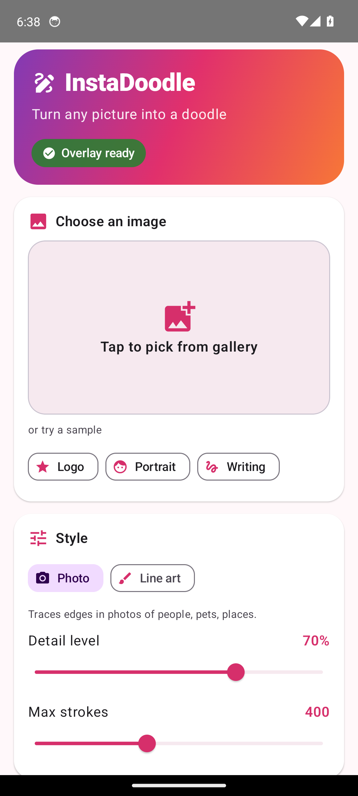
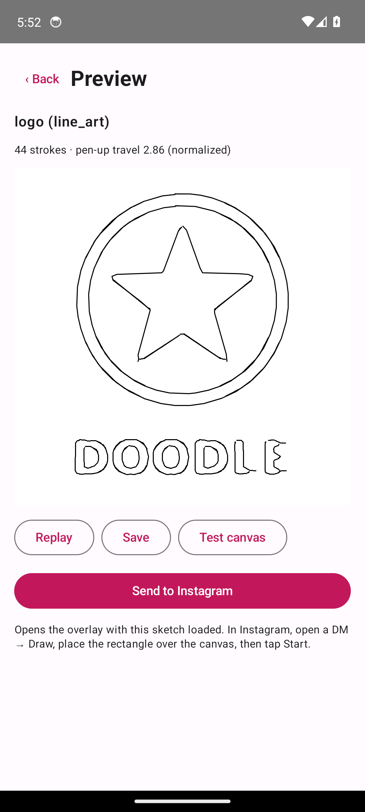
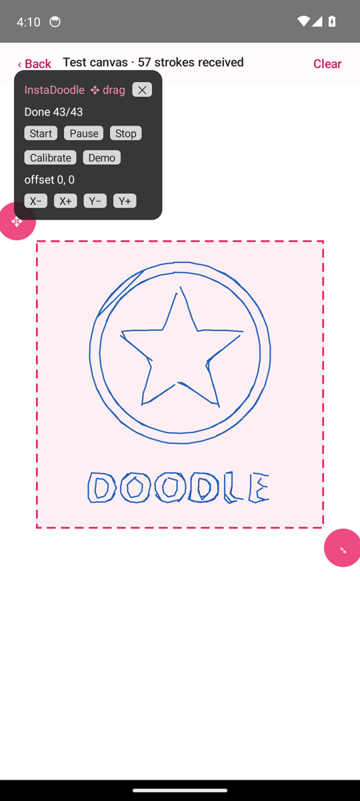
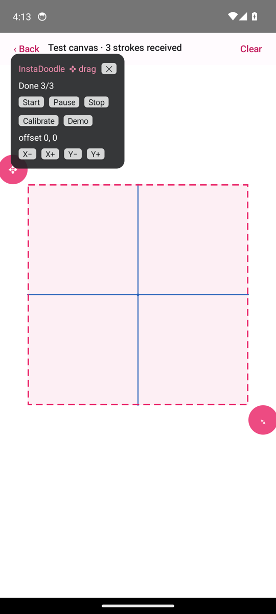
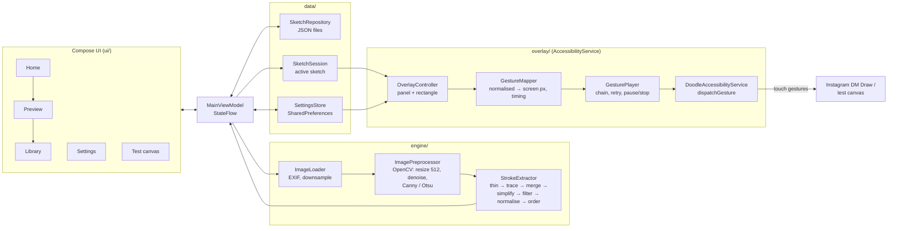

# InstaDoodle

**Turn any picture into a hand-drawn doodle and have your phone draw it for you, stroke by stroke.**

InstaDoodle converts an image into a small set of simplified pen strokes, previews them as a
drawing animation, and replays them as touch gestures through an Android
`AccessibilityService` overlay. The target is the Draw canvas in Instagram DMs, but it works on
any app that accepts finger drawing (an in-app test canvas is included).

> **Status:** verified on the in-app test canvas on an Android 14 emulator. **It has not been
> tested in the real Instagram app.** See [docs/INSTAGRAM_TEST_CHECKLIST.md](docs/INSTAGRAM_TEST_CHECKLIST.md)
> and [PROGRESS.md](PROGRESS.md).

| Home | Preview | Drawing on test canvas | Calibration |
| --- | --- | --- | --- |
|  |  |  |  |

More in [docs/screenshots](docs/screenshots).

## Features

- **Image → strokes engine**: Photo Picker or bundled samples; PHOTO (difference-of-Gaussians
  edges) and LINE_ART (Otsu threshold) modes; Zhang-Suen thinning, skeleton tracing,
  Ramer-Douglas-Peucker simplification, endpoint merging, short-stroke removal, a stroke cap
  (default 250), and greedy nearest-neighbour ordering with stroke reversal plus 2-opt to cut
  pen-up travel. Output points are normalised to `[0,1]`.
- **Preview**: animated replay of the strokes, stroke count and pen-up travel.
- **Library**: sketches saved as JSON in app-private storage.
- **Overlay** (`TYPE_ACCESSIBILITY_OVERLAY`): Start / Pause-Resume / Stop / Calibrate / Demo,
  live progress, a draggable + resizable placement rectangle that is `FLAG_NOT_TOUCHABLE`, and
  X/Y offset nudges saved to preferences.
- **Gesture replay**: one `dispatchGesture()` per stroke, chained from `onCompleted`; cancelled
  strokes retried up to twice (with a short back-off so your own taps get through) then skipped;
  stop cancels immediately.
- **Every timing parameter is a setting**: speed (px/s), min/max stroke duration (also clamped to
  the platform max gesture duration), delay between strokes, dot duration (≥ 40 ms).
- **Onboarding** including the Android 13+ "Allow restricted settings" step for sideloaded apps.
- **Private by design**: no `INTERNET` permission, no backend, no root, no hooking. The
  accessibility service subscribes to no events and has `canRetrieveWindowContent="false"`, so it
  cannot read Instagram (or any other app).

## Architecture



Single module, MVVM, coroutines/Flow. OpenCV (`org.opencv:opencv:4.9.0`) does the pixel work;
thinning, tracing, simplification, filtering and ordering are pure Kotlin so they are unit-tested
on the JVM.

## Build and install

Prerequisites: JDK 17, Android SDK with platform 34 (Android Studio Koala or newer works).

```bash
./gradlew assembleDebug                 # app/build/outputs/apk/debug/app-debug.apk
./gradlew testDebugUnitTest             # JVM tests (engine + gesture player)
./gradlew connectedDebugAndroidTest     # OpenCV pipeline on a device/emulator
adb install -r app/build/outputs/apk/debug/app-debug.apk
```

Or download `instadoodle-debug-apk` from the latest **Android CI** run in GitHub Actions.
Tagging `v*` runs **Release APK**, which builds a release APK (signed if the `RELEASE_KEYSTORE_*` / `RELEASE_KEY_*`
secrets are set) and attaches it to the GitHub release.

### First run

1. Open InstaDoodle and follow onboarding: enable **Settings → Accessibility → InstaDoodle**.
2. Android 13+: if the switch is greyed out, open **App info → ⋮ → Allow restricted settings**, then retry.
3. Pick an image (or a sample), choose PHOTO or LINE_ART, adjust Detail / Max strokes, **Generate sketch**.
4. In Preview: **Replay** to watch, **Save** to the library, **Test canvas** to try the overlay, or
   **Send to Instagram**.

## Instagram tuning guide

1. **Send to Instagram** → open a DM → camera/editor → **Draw**.
2. Drag ✥ to move and ⤡ to resize the dashed rectangle over the canvas, clear of toolbars.
3. Tap **Calibrate**; nudge X/Y until the cross is centred.
4. **Start** with defaults (1200 px/s, 60–4000 ms per stroke, 150 ms between strokes, 40 ms dots).
5. Dropped strokes → more delay between strokes, lower speed. Lag → more delay, fewer max
   strokes. Misalignment → calibrate + offsets. Full table in the
   [checklist](docs/INSTAGRAM_TEST_CHECKLIST.md#6-tuning-guide).

## Limitations

- Not tested on real Instagram; it may ignore, smooth or drop injected gestures, and its UI can change.
- Strokes longer than the platform maximum gesture duration are sped up, not split.
- Photos produce outline-style doodles, not shading. Busy photos need lower Detail / fewer strokes.
- Touching the screen while drawing cancels the current stroke (it is retried up to twice).
- Verified on one emulator (API 34, x86_64) only.

## Project records

[PROGRESS.md](PROGRESS.md) · [CHANGELOG.md](CHANGELOG.md) · [AI_USAGE.md](AI_USAGE.md) ·
[SUBMISSION.md](SUBMISSION.md) · Hackathon: [RULES.md](RULES.md), [AGENTS.md](AGENTS.md),
[event on Luma](https://luma.com/z10nz8gp)
